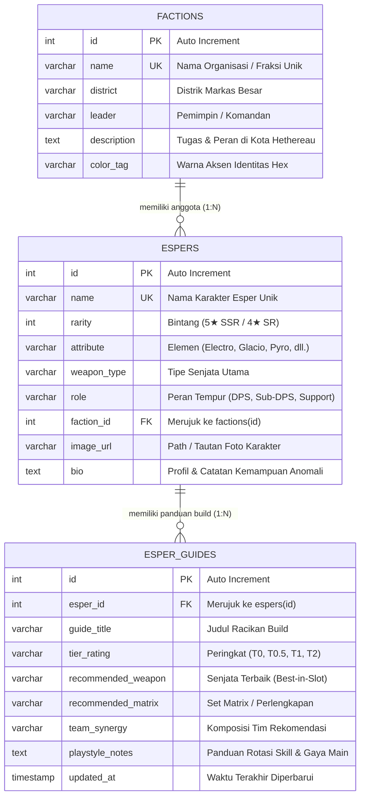
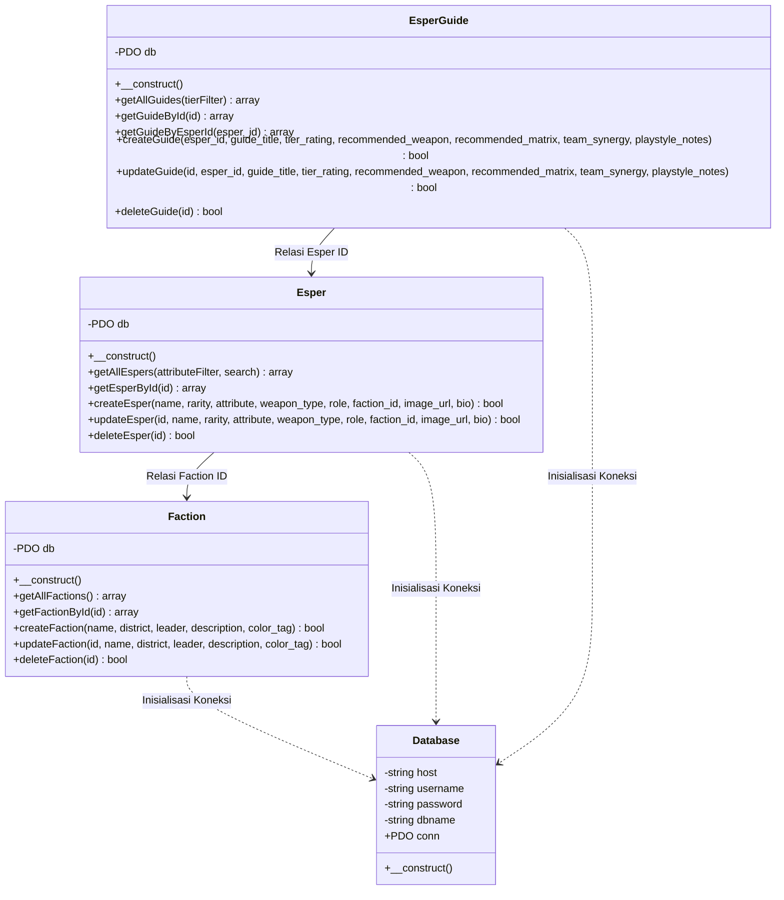
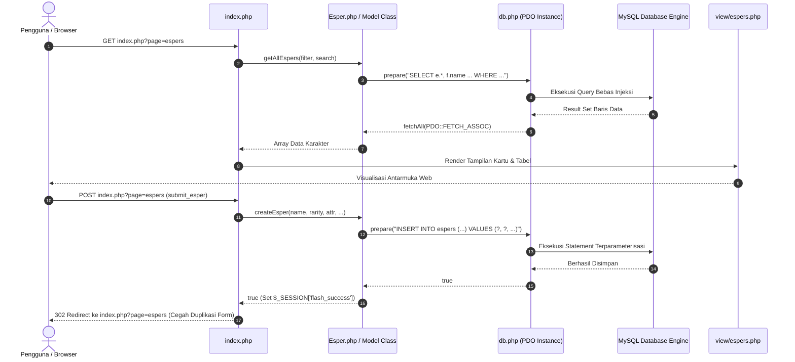

# TP7 DPBO 2025/2026 - Web PHP Native OOP: Neverness to Everness (NTE) Supernatural Esper Database & Guide Hub (PDO MySQL, Prepared Statements, & Vanilla CSS)

Tugas Praktikum 7 mata kuliah Desain dan Pemrograman Berorientasi Objek (DPBO), Program Studi Ilmu Komputer, Fakultas Pendidikan Matematika dan Ilmu Pengetahuan Alam, Universitas Pendidikan Indonesia, semester genap 2025/2026.

---

## Janji Kejujuran Akademik

Saya Devindra Azra Dwi Putra dengan NIM 2509003 mengerjakan TP 7 dalam mata kuliah DPBO untuk keberkahan-Nya maka saya tidak melakukan kecurangan seperti yang telah dispesifikasikan. Aamiin.

---

## 1. Deskripsi Singkat & Tema Website

Aplikasi ini adalah situs web panduan komunitas dan arsip basis data karakter untuk game gacha: **Neverness to Everness (NTE)** karya Hotta Studio. Terinspirasi oleh antarmuka dashboard seperti **Prydwen Institute**, sistem ini menyediakan katalog karakter Esper, pemetaan fraksi distrik Kota Hethereau, serta rekomendasi racikan *build* dan peringkat kekuatan (*Tier List*).

Aplikasi dibangun murni menggunakan **PHP Native Berorientasi Objek (OOP)** tanpa framework backend (seperti Laravel/CodeIgniter) dan tanpa library CSS eksternal (seperti Bootstrap/Tailwind). Seluruh interaksi basis data dihubungkan ke **MySQL Server** melalui antarmuka **PDO (PHP Data Objects)** dengan penegakan **100% Prepared Statements** untuk menjamin keamanan mutlak terhadap ancaman *SQL Injection*.

### Fitur-Fitur Utama Sistem:
1. **Katalog Esper & Filter Elemen**: Menampilkan daftar karakter dengan kartu visual modern, sistem avatar *fallback* otomatis, pencarian instan berdasarkan nama, dan filter navigasi cepat berdasarkan 6 elemen (*Electro, Glacio, Pyro, Physical, Aero, Quantum*).
2. **Manajemen Fraksi Kota Hethereau**: Menampilkan organisasi kota dengan identitas warna aksen, distrik markas, nama pemimpin, serta penghitung anggota Esper yang bernaung di bawahnya secara dinamis (*real-time count*).
3. **Tier List & Build Guide Hub**: Sistem perumusan rekomendasi senjata utama (*best-in-slot*), set perlengkapan matrix, sinergi tim, catatan rotasi tempur, dan pengelompokan tingkat tier (*T0 Apex Meta, T0.5 High Priority, T1 Competitive, T2 Situational*).
4. **Full Relational CRUD**: Seluruh 3 entitas mendukung operasi **Create, Read, Update, Delete** secara penuh dan tersinkronisasi antar tabel menggunakan relasi *Foreign Key* bertingkat.
5. **PRG Pattern & Flash Feedback**: Mengadopsi arsitektur *Post/Redirect/Get* untuk mencegah duplikasi data saat me-refresh browser, dilengkapi pesan umpan balik interaktif (*alert success/error*).

---

## 2. Struktur Proyek Modular (Standard DPBO)

Struktur direktori proyek dirancang bersih dengan memisahkan tanggung jawab (*Separation of Concerns*):

```text
TP7DPBO2526C2/
├── assets/                    # Berkas Aset Gambar Asli Lokal (ntebuild.com)
│   └── images/
│       ├── characters/        # Ikon avatar & portrait karakter resmi NTE
│       └── ui/                # Logo resmi game Neverness to Everness
├── class/                     # Kelas-kelas Model Entitas & Logika Bisnis (OOP)
│   ├── Faction.php            # Model pengelola tabel fraksi (CRUD Faction)
│   ├── Esper.php              # Model pengelola tabel esper (CRUD Esper & filter relasional)
│   └── EsperGuide.php         # Model pengelola panduan build (CRUD Guide & Tier List)
├── config/                    # Konfigurasi aplikasi & database
│   └── db.php                 # Kelas pembantu koneksi PDO terpusat
├── database/                  # Skrip SQL DDL & dummy data
│   └── db_nte_guide.sql       # Struktur tabel & data awal NTE
├── view/                      # Komponen antarmuka pengguna (HTML Modular)
│   ├── header.php             # Navigasi atas, logo resmi NTE, & status server
│   ├── footer.php             # Catatan hak cipta & identitas mahasiswa
│   ├── dashboard.php          # Ringkasan statistik & highlight Apex Meta
│   ├── espers.php             # Halaman katalog, kartu visual, tabel, & form Esper
│   ├── factions.php           # Halaman kartu fraksi, distrik, tabel, & form Fraksi
│   └── guides.php             # Halaman Tier List, panduan build, tabel, & form Guide
├── Dokumentasi/               # Berkas rekaman layar demonstrasi & bukti pengujian
│   └── dokumentasi CRUD.mp4   # Video rekaman demonstrasi operasi CRUD seluruh entitas
├── .gitignore                 # Konfigurasi pengabaian file temp & IDE
├── index.php                  # Entry point utama, router halaman, & penangan request HTTP
├── style.css                  # Berkas stylesheet Vanilla CSS murni (Anti-Slop compliant)
└── README.md                  # Dokumentasi teknis komprehensif
```

---

## 3. Desain Basis Data Relasional & Skema Tabel

Basis data `db_nte_guide` terdiri dari **3 entitas tabel utama** yang terhubung melalui relasi *Foreign Key* berkekuatan referensial *Cascade*:



### Kamus Data (Data Dictionary)

#### A. Tabel `factions`
| Nama Kolom | Tipe Data | Keterangan |
| :--- | :--- | :--- |
| `id` | `INT` (PK, AI) | Identifikator unik fraksi. |
| `name` | `VARCHAR(100)` (Unique, NOT NULL) | Nama fraksi perkotaan (misal: *Eibon Antiquities, Kuroshio Syndicate*). |
| `district` | `VARCHAR(100)` (NOT NULL) | Kawasan markas utama di Kota Hethereau. |
| `leader` | `VARCHAR(100)` (NOT NULL) | Nama pemimpin fraksi. |
| `description` | `TEXT` (NOT NULL) | Profil ringkas yurisdiksi dan operasi fraksi. |
| `color_tag` | `VARCHAR(20)` | Kode warna heksadesimal untuk aksen visual kartu. |

#### B. Tabel `espers`
| Nama Kolom | Tipe Data | Keterangan |
| :--- | :--- | :--- |
| `id` | `INT` (PK, AI) | Identifikator unik Esper. |
| `name` | `VARCHAR(100)` (Unique, NOT NULL) | Nama karakter Esper (misal: *Nanally, Mint, Sakiri, Beverly*). |
| `rarity` | `INT` (NOT NULL, Default 5) | Tingkat kelangkaan (5 untuk SSR, 4 untuk SR). |
| `attribute` | `VARCHAR(50)` (NOT NULL) | Elemen kekuatan (*Electro, Glacio, Pyro, Physical, Aero, Quantum*). |
| `weapon_type` | `VARCHAR(50)` (NOT NULL) | Tipe senjata (*Dual Pistols, Katana, Tactical Catalyst, Heavy Greatsword*). |
| `role` | `VARCHAR(50)` (NOT NULL) | Spesialisasi tempur (*Main DPS, Burst Sub-DPS, Buffer/Healer, Tank/Shielder*). |
| `faction_id` | `INT` (FK, NOT NULL) | Kunci tamu yang menghubungkan Esper ke tabel `factions(id)`. |
| `image_url` | `VARCHAR(255)` | Path gambar lokal atau tautan web (mendukung avatar otomatis jika kosong). |
| `bio` | `TEXT` | Uraian latar belakang karakter dan karakteristik anomali. |

#### C. Tabel `esper_guides`
| Nama Kolom | Tipe Data | Keterangan |
| :--- | :--- | :--- |
| `id` | `INT` (PK, AI) | Identifikator unik panduan build. |
| `esper_id` | `INT` (FK, NOT NULL) | Kunci tamu yang menghubungkan panduan ke tabel `espers(id)`. |
| `guide_title` | `VARCHAR(200)` (NOT NULL) | Nama judul panduan (misal: *Nanally Hyper-Electro Rapid Trigger*). |
| `tier_rating` | `VARCHAR(10)` (NOT NULL) | Rating kekuatan meta (*T0, T0.5, T1, T2*). |
| `recommended_weapon`| `VARCHAR(150)` (NOT NULL) | Senjata optimal (*Best-in-Slot*). |
| `recommended_matrix`| `VARCHAR(150)` (NOT NULL) | Set modul penguat atau matrix anomali. |
| `team_synergy` | `VARCHAR(255)` (NOT NULL) | Pasangan karakter Esper pendukung terbaik. |
| `playstyle_notes` | `TEXT` (NOT NULL) | Trik kombo, rotasi *dodge*, dan urutan *burst*. |
| `updated_at` | `TIMESTAMP` | Penanda waktu otomatis saat panduan diperbarui. |

---

## 4. Desain Arsitektur Kelas Berorientasi Objek (OOP Class Diagram)

Sistem mengadopsi prinsip pemisahan kelas model mandiri, enkapsulasi atribut koneksi, serta injeksi dependensi koneksi PDO:



---

## 5. Alur Program & Penegakan Prepared Statements

### A. Alur Komunikasi HTTP & PRG Pattern



### B. Bukti Kepatuhan Prepared Statement (Zero SQL Injection)
Seluruh query di dalam `Faction.php`, `Esper.php`, dan `EsperGuide.php` ditulis dengan parameter placeholder (`?`) dan dieksekusi via `execute([$param1, ...])`:
```php
// Contoh pada class/Esper.php:
$sql = "INSERT INTO espers (name, rarity, attribute, weapon_type, role, faction_id, image_url, bio) 
        VALUES (?, ?, ?, ?, ?, ?, ?, ?)";
$stmt = $this->db->prepare($sql);
return $stmt->execute([$name, $rarity, $attribute, $weapon_type, $role, $faction_id, $image_url, $bio]);
```
Tidak ada satupun pemanggilan query mentah yang menggabungkan variabel langsung dengan operator titik (`.` atau `mysqli_query`).

---

---

## 6. Matriks Fungsionalitas & Pengujian Fitur CRUD

Seluruh fitur telah teruji dan berjalan normal:

| Entitas Basis Data | Create (Tambah) | Read (Tampil / Filter) | Update (Ubah) | Delete (Hapus) | Keterangan Relasi |
| :--- | :---: | :---: | :---: | :---: | :--- |
| **Factions** | ✅ Berhasil | ✅ Kartu & Tabel | ✅ Berhasil | ✅ Berhasil (Konfirmasi) | Entitas induk distrik kota |
| **Espers** | ✅ Berhasil | ✅ Kartu, Tabel, & Filter Atribut | ✅ Berhasil | ✅ Berhasil (Konfirmasi) | Many-to-One ke `factions(id)` |
| **Esper Guides** | ✅ Berhasil | ✅ Tier List T0-T2 & Tabel | ✅ Berhasil | ✅ Berhasil (Konfirmasi) | Many-to-One ke `espers(id)` |

---

## 7. Dokumentasi Pengujian & Bukti Eksekusi Program

Bagian ini menyajikan dokumentasi video rekaman demonstrasi eksekusi fitur Create, Read, Update, dan Delete (CRUD) secara menyeluruh pada aplikasi **Neverness to Everness (NTE) Esper Database & Guide Hub**:

### A. Video Rekaman Demonstrasi Eksekusi Program (CRUD All Entities)
Seluruh fungsionalitas aplikasi dan interaksi basis data telah didokumentasikan dalam format rekaman video:

- **Berkas Video Rekaman**: [`Dokumentasi/dokumentasi CRUD.mp4`](Dokumentasi/dokumentasi%20CRUD.mp4)
- **Ringkasan Cakupan Demonstrasi Video (`dokumentasi CRUD.mp4`)**:
  1. **Tinjauan Beranda (Dashboard)**:
     - Tampilan statistik dinamis (*Total Esper*, *Fraksi & Organisasi*, *Panduan Build*, dan *Apex Meta Tier 0*).
     - Navigasi responsif dengan logo resmi *Neverness to Everness* dan indikator status server aktif.
  2. **Pengujian CRUD Entitas 1: Factions (Fraksi Kota Hethereau)**:
     - **Read**: Menampilkan kartu fraksi beserta distrik, pemimpin, warna aksen identitas, dan jumlah anggota Esper terdaftar.
     - **Create**: Menambahkan fraksi baru melalui form interaktif dengan umpan balik pesan sukses (*flash alert*).
     - **Update**: Mengubah rincian nama/pemimpin/deskripsi fraksi dan melihat pembaruan data secara langsung.
     - **Delete**: Menghapus fraksi dengan dialog konfirmasi sebelum eksekusi SQL.
  3. **Pengujian CRUD Entitas 2: Espers (Karakter Esper)**:
     - **Read & Filter**: Menampilkan katalog kartu Esper dengan potret asli dari *ntebuild.com*, bintang kelangkaan (5★/4★), serta lencana elemen.
     - **Filter Elemen & Pencarian**: Mendemonstrasikan filter instan berdasarkan elemen (*Electro, Glacio, Pyro, dll.*) dan pencarian nama karakter.
     - **Create**: Mendaftarkan Esper baru terhubung ke fraksi melalui *Foreign Key dropdown*.
     - **Update**: Memperbarui peran tempur atau deskripsi profil karakter.
     - **Delete**: Menghapus karakter dengan dialog konfirmasi terintegrasi.
  4. **Pengujian CRUD Entitas 3: Esper Guides (Tier List & Panduan Build)**:
     - **Read & Tier Filter**: Menampilkan tier list ala *Prydwen* dengan filter tab (*T0, T0.5, T1, T2*) beserta racikan senjata *Best-in-Slot*, set matrix, dan sinergi tim.
     - **Create**: Membuat panduan build baru yang ditautkan ke salah satu Esper melalui relasi *Foreign Key*.
     - **Update**: Memperbarui senjata rekomendasi atau catatan rotasi gaya bermain.
     - **Delete**: Menghapus panduan build dari sistem dengan konfirmasi dialog.
  5. **Verifikasi Integritas Basis Data**:
     - Memperlihatkan bahwa seluruh aksi termutasi secara *real-time* ke server MySQL via **PDO Prepared Statements** tanpa kegagalan query.

---

### B. Rincian Antarmuka yang Didemonstrasikan dalam Video
1. **Beranda & Statistik Dashboard**: Menampilkan ringkasan statistik total karakter, fraksi, panduan aktif, serta kartu highlight karakter Tier 0 (Apex Meta).
2. **Katalog Karakter Esper & CRUD Esper**: Kartu karakter bergaya *Prydwen*, tombol filter elemen instan, formulir pendaftaran Esper baru dengan relasi ke Fraksi, dan pengeditan data.
3. **Manajemen Fraksi Kota Hethereau**: Kartu fraksi dengan garis aksen warna heksadesimal, jumlah anggota Esper terdaftar, serta formulir penambahan dan pengubahan fraksi.
4. **Tier List & Panduan Build Esper**: Filter tab Tier (*T0, T0.5, T1, T2*), rincian rekomendasi senjata, set matrix, sinergi tim, serta form pembuatan panduan build baru.
